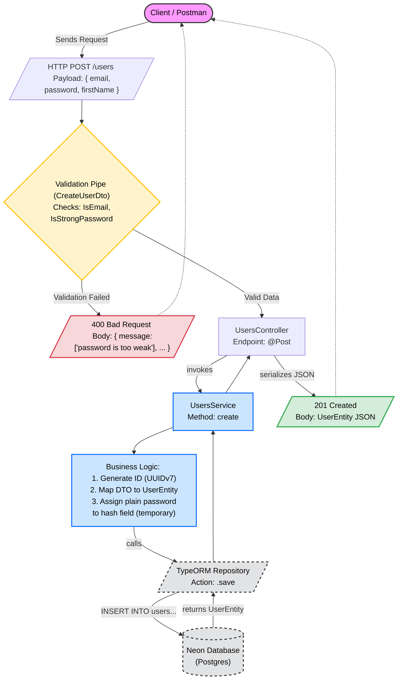

# Fit Tracker Backend API

### User Registration Flow



### Test user

```
{
    "firstName": "TestUser",
    "email": "test@example.com",
    "password": "3edc$RFV"
}
```

### Auth configuration

Token lifetimes are configured in whole seconds and validated at startup
(`src/config/env.validation.ts`): both values are required, must be positive
integers, and the access lifetime must be strictly shorter than the refresh
lifetime.

| Env var                            | Documented default | Notes                                    |
| ----------------------------------- | ------------------- | ----------------------------------------- |
| `JWT_ACCESS_TOKEN_EXPIRATION_TIME`  | `900` (15 min)       | Access JWT lifetime, in seconds           |
| `JWT_REFRESH_TOKEN_EXPIRATION_TIME` | `604800` (7 days)    | Refresh session lifetime, in seconds      |
| `AUTH_COOKIE_SAME_SITE`             | `lax`                | `lax` \| `strict` \| `none`; `none` forces `Secure` |

The refresh cookie (`refreshToken`) is `HttpOnly`, host-only, scoped to
`Path=/api/v1/auth`, and `Secure` in production (or whenever
`AUTH_COOKIE_SAME_SITE=none`). `POST /api/v1/auth/logout` revokes only the
session addressed by that cookie; other sessions/devices for the same user
remain valid.

### Database migrations in production

`synchronize` is always `false`. The container image runs
`node dist/db/migrate.js` (a compiled entrypoint that builds on
`src/db/data-source.ts`) before starting the app (see `Dockerfile`); a failed
migration fails the container start instead of booting against a stale
schema.

The migrations-history table name is `migrations` (the TypeORM default) on
both the CLI (`npm run migration:*`, via `src/db/data-source.ts`) and the app
(`src/db/typeorm-config.service.ts`). This was chosen deliberately: before
this change the app config declared `migrationsTableName: 'migration'`
(singular) while `data-source.ts` — the only DataSource that has ever
actually executed a migration, via the CLI — used the untouched TypeORM
default (`migrations`, plural). Since no production path ran migrations
through the app's DataSource, any already-applied migration history in a
real database was necessarily recorded under `migrations` (plural). Both
files now agree on `migrations` so the compiled `migrate.js` step reads/writes
the same history table the CLI already used, instead of starting a second,
empty history table and risking re-running already-applied migrations.

To run migrations manually against a target database:

```
npm run migration:run
```

Never run `migration:revert` against a database that isn't known to be
disposable.

### TLS to the database

By default (`NODE_ENV=production` or a `neon.tech` host) the app connects
over TLS with `rejectUnauthorized: false` (unchanged default behavior). Set
`DB_SSL_CA` to a PEM-encoded CA certificate to verify the server certificate
instead (`rejectUnauthorized: true`, `ca: DB_SSL_CA`). Leave it unset to keep
current behavior.

### Reverse proxy / trust proxy

Optional `TRUST_PROXY` env var: a non-negative integer hop count. When set,
the app calls `app.set('trust proxy', <n>)` so `req.ip` (used by the
throttler) reflects the real client through that many trusted proxy hops.
Leave unset to keep current behavior (no proxy trust).

When deployed behind Netlify → Railway, count each hop the request passes
through before reaching this app (typically 1 for Netlify's edge proxy, plus
any hop Railway's own router adds — verify with your Railway plan/docs) and
set `TRUST_PROXY` accordingly.

The built-in throttler's storage is in-memory per app instance; rate limits
are per-instance, not global across multiple replicas.